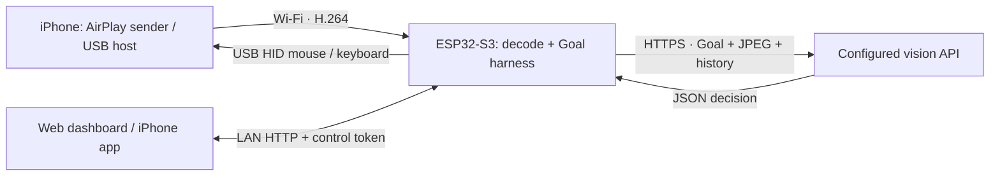

# ESP32 iPhone Agent

**A Goal-driven iPhone automation controller running on an ESP32-S3.**

[简体中文](README.zh-CN.md) · [Documentation](docs/guide/README.md) · [Demo video](docs/demo/demo.mp4)

The ESP32 receives the iPhone's AirPlay stream, decodes H.264, sends grayscale
screenshots to your configured vision API, and selects USB mouse/keyboard actions.
The iPhone app handles setup and task submission; the web dashboard monitors the
screen and explains each execution round. A Mac is needed for development and
flashing, and can optionally remain as a monitoring client.

**This repository documents the `--cloud` firmware.** The legacy iPhone-side
agent and Python server remain in the source tree, but are not the current runtime.
The current app defaults to the Wi-Fi controller, so build firmware with `--cloud`.

## What the current version does

- Token-gated web and iOS controllers, mDNS discovery at `http://iphone-agent.local/`.
- Board-side OpenH264 decoder, grayscale JPEG monitoring, configurable 3/5/10-second refresh.
- A Goal loop with six recent actions, progress summaries, subgoals and expected outcomes.
- Fresh-screen completion verification, stalled-action replanning, bounded retries and cancellation.
- Limits of 20 action attempts, 40 model calls and ten minutes per task.
- Shared API endpoint/model/key configuration, 12 iPhone task examples and 13 web examples.

## Documentation

| Guide | Contents |
|---|---|
| [Hardware and wiring](docs/guide/hardware.md) | Measured board specifications, iPhone 13 host adapter, cables, power, network |
| [Architecture](docs/guide/architecture.md) | Components, concurrency, memory, current vs. legacy modes |
| [Business flow](docs/guide/workflow.md) | Setup, Goal loop, verification, pause/stop paths |
| [Data flow and API](docs/guide/data-flow.md) | Video/control/model paths, sequence diagram, endpoint table, data handling |
| [Code map](docs/guide/code-map.md) | Directory tree and implementation entry points |
| [Installation](docs/guide/install.md) | Tool versions, firmware, iOS signing, first connection, tests |
| [User manual](docs/guide/manual.md) | Daily usage, calibration, examples, model settings, troubleshooting |
| [Validation and limits](docs/guide/validation.md) | What was measured, what is simulated, what still needs hardware validation |
| [Demo and reproduction](docs/demo/README.md) | MP4, chapters, reproducible recording script |

## Hardware at a glance

| Item | This project's setup |
|---|---|
| Board | ESP32-S3 rev. 0.2; measured 16 MB flash / 8 MB PSRAM; board vendor/model unconfirmed |
| Phone | iPhone 13, Lightning connector |
| USB host adapter | Lightning-to-USB host/camera adapter required for iPhone 13; an ordinary charge/data cable is insufficient |
| Network | Internet-connected router with 2.4 GHz for the ESP32 and client-to-client LAN access |
| Development Mac | MacBook Pro, M1 Pro, 16 GB RAM; Xcode and Arduino CLI |

The firmware currently uses an **8 MB flash partition layout** even on the measured
16 MB board. Native USB and the configured OPI PSRAM mode must match your hardware.
Do not assume every ESP32 variant or USB-to-UART connector can provide USB HID.

## Quick start

1. Clone this repository and follow [installation](docs/guide/install.md).
2. Copy `hardware/hid_bridge/secrets.example.h` to the ignored `secrets.h`; fill in
   your own Wi-Fi and vision API values.
3. Build/flash using `hardware/flash.sh --cloud --debug`.
4. Install the iOS project using your own signing team and bundle ID.
5. Join the same LAN, enable Screen Mirroring → **ESP32 Agent**, connect the phone
   as the USB host, enable AssistiveTouch, confirm the wiring and calibrate.
6. Log into `http://iphone-agent.local/` or the app with the board's control token,
   submit a Goal, and leave the iPhone app while the board works.

The control token is generated by the board and can be read over USB serial with
`1 agent token`. It is separate from your cloud API key. Wi-Fi connects at boot,
independently of dashboard login. IP addresses come from DHCP, not a hard-coded IP.

## Demo and validation boundary

[Watch/download the MP4](docs/demo/demo.mp4). The video records the actual web UI
with synthetic phone screens and mocked task events. It is **not a recording of
successful physical iPhone HID automation**. The overlay identifies this throughout.
Firmware flashing, decoder regression, cloud response parsing, controller tests
and cancellation were verified separately. The final physical iPhone HID loop
remains unverified because the phone host adapter and active mirror were unavailable.
See [validation](docs/guide/validation.md).

The [GitHub Actions template](tools/ci/README.md) is included but is not enabled on this repository.
Local validation results are recorded in the guide above.

## Source and licensing

This is a derivative of [onehumanbeing/esp32-iphone-agent](https://github.com/onehumanbeing/esp32-iphone-agent),
based on upstream commit `67da886`. Original code and notices are retained.
See [NOTICE](NOTICE.md), [LICENSE](LICENSE), and the component license files;
the AirPlay/playfair and OpenH264 portions have their own terms. Historical upstream
material is under [docs/guide](docs/guide/upstream-readme.en.md).

Local keys, Wi-Fi credentials, device tokens, private recordings, signing config,
and firmware binaries containing those values are intentionally excluded from Git.
