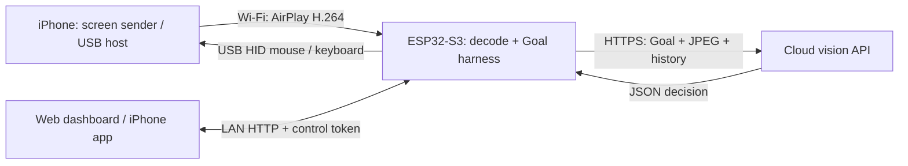
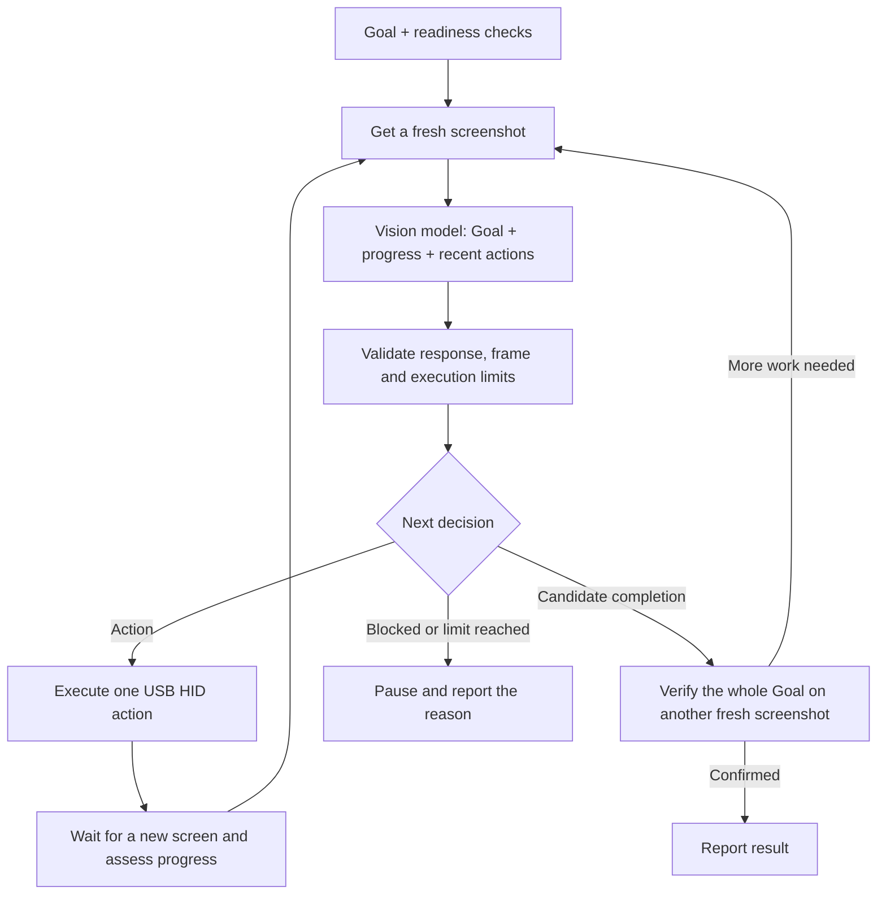

<div align="center">


# ESP32 iPhone Agent

**An ESP32-S3-powered iPhone automation agent with a goal-driven execution loop.**

[简体中文](README.zh-CN.md) · [Watch demo online](https://infronai.github.io/esp32-iphone-agent/demo/) · [Documentation](#documentation)

</div>

Give the agent a goal, such as “Open Settings and tell me the current Wi-Fi network.”
The ESP32 receives the iPhone's AirPlay screen stream, decodes it, asks a cloud vision
model what to do next, and schedules USB mouse or keyboard actions. Each new screen
feeds the next decision, and completion requires another screenshot to verify the result.

The iPhone app handles setup and task submission; the web dashboard shows the phone
screen and execution details. The task loop runs on the ESP32, so the phone can leave
the controller app and display the app being operated. A Mac is used for development,
flashing and optional monitoring; it does not run the current agent or decode its video.

> **Current mode: `hardware/flash.sh --cloud`.** Without `--cloud`, the build selects
> the retained legacy BLE bridge. The current iOS app defaults to the Wi-Fi controller.
> Physical iPhone HID end-to-end validation is still pending; see the validation record below.

## What the current version does

- Receives AirPlay, decodes H.264 on the board and produces grayscale JPEG screenshots.
- Runs a Goal loop with recent-action memory, progress summaries, subgoals and expected outcomes.
- Replans after stalled actions, retries transient failures within limits and verifies completion on a fresh screen.
- Provides token-authenticated web and iOS controllers with shared endpoint, model and API key settings.
- Shows phone monitoring and task details together, including inputs, observations, action parameters and results.
- Includes 12 iPhone task examples and 13 web examples, with a web-only screen-reading check that needs no HID.

## Demo and validation boundary

[](https://infronai.github.io/esp32-iphone-agent/demo/)

**[▶ Watch the 71-second demo online](https://infronai.github.io/esp32-iphone-agent/demo/)** —
play, pause, seek, switch to full screen or jump between nine chapters without downloading a file.

The video records the **actual dashboard with simulated phone screens and task responses**.
It shows login, monitoring, Goal execution, completion checks, replanning, stopping and model
configuration. It is not a recording of successful physical iPhone USB HID automation.
The video and player both identify that boundary. [Recording and reproduction](docs/demo/README.md).

## Documentation

The following overview covers the current system from hardware to daily use, so you can
understand the project before opening individual guides. The [detailed documentation](docs/guide/README.md)
is currently in Chinese; this English overview provides the same project-level orientation.

### Hardware and wiring

| Item | Recorded setup and requirements |
|---|---|
| ESP32 board | ESP32-S3 rev. 0.2; measured **16 MB flash / 8 MB PSRAM**; board vendor and printed model unconfirmed |
| Phone | **iPhone 13**, with a Lightning connector |
| Phone USB host adapter | Lightning-to-USB host/camera adapter required for this phone; an ordinary charge/data cable is insufficient |
| Network | Internet-connected router with **2.4 GHz** for the ESP32 and client-to-client LAN access |
| Development computer | MacBook Pro, M1 Pro, 16 GB RAM; Xcode and Arduino CLI |
| Cables and power | Data-capable cable to the board's native USB/OTG port; a USB hub was used during development; power must follow the board/adapter specifications |

The firmware uses an **8 MB flash partition layout** and **OPI PSRAM**, even on the measured
16 MB board. Check those settings against your own board. A USB-to-UART programming port
is not interchangeable with the native USB port used for HID.

During development the board connects to the Mac. During phone operation, its native USB
connects to the **iPhone as USB host through the adapter**, while the Mac monitors over Wi-Fi.
USB enumeration alone cannot identify the host as an iPhone: do not confirm phone wiring
or run pointer calibration while the board's HID connection is still attached to the Mac.

The phone, ESP32 and monitoring browser share a reachable LAN. The phone and Mac may use
a different Wi-Fi band if the router permits communication and mDNS discovery.
[Full hardware list and wiring diagrams →](docs/guide/hardware.md)

### Architecture and responsibilities



| Component | Responsibility |
|---|---|
| iPhone system | Sends Screen Mirroring video, runs the target app and accepts pointer/keyboard input through AssistiveTouch and USB host mode |
| ESP32 visual pipeline | Receives and decrypts AirPlay, continuously decodes H.264 with OpenH264 and exports the latest grayscale JPEG |
| ESP32 Goal harness | Maintains task context, validates model proposals, checks progress and budgets, queues actions and verifies completion |
| Cloud vision model | Reads the screenshot and task context, then returns one structured decision; the model does not directly access USB |
| iPhone controller app | Guides phone setup, displays readiness, submits/stops tasks and edits the board's model settings |
| Web dashboard | Displays screenshots, task input and execution timeline; also handles tasks, pointer calibration and model settings |

HTTP serving, model requests and video processing run separately. Actual HID dispatch happens
in the Arduino loop. Actions carry task/session identifiers so a stopped task or replaced
mirror session cannot execute an old model response.
[Architecture, concurrency and memory →](docs/guide/architecture.md)

### Goal execution flow

A Goal describes an outcome, rather than a fixed sequence of taps. If the phone is already
on the desired page, the agent can verify that state; if a previous action failed to change
the screen, the next decision uses that feedback.



The harness remembers the **last six actions**, a progress summary, current subgoal and
expected screen change. It distinguishes command acknowledgement from visual success.
Repeated actions without progress trigger replanning; an uncertain or partially executed
action is not blindly replayed.

Each task is bounded by **20 action attempts, 40 model calls and ten minutes**, with at most
two consecutive retries for retryable failures. Stopping invalidates subsequent actions,
even if a model request returns later. New tasks and reboots clear task memory.
[Detailed business flow and exception paths →](docs/guide/workflow.md)

### Data flow, configuration and access

- **Video:** iPhone → AirPlay H.264 → board decoder → grayscale JPEG. The dashboard fetches
  the latest JPEG; the cloud receives a JPEG image, not the original H.264 stream.
- **Decision:** Goal + screenshot + recent actions/feedback → HTTPS Chat Completions endpoint
  → validated JSON decision → board action queue → USB HID → next screenshot.
- **Monitoring:** the controllers read board status and task events over LAN HTTP. The web
  page defaults to a **five-second** screenshot interval, with three- and ten-second options.
  This refresh setting is independent of video decoding and model latency.
- **Configuration:** Wi-Fi connects at boot. The control token and model configuration survive
  normal reboots in NVS. Endpoint, model and API key can be edited from either controller.

The control token protects the board APIs and is separate from the model API key. Local HTTP
is not encrypted; cloud requests use HTTPS certificate verification. Model keys are not
returned by the configuration API. Screenshots and task history are runtime buffers, not a
persistent recording service. The selected provider receives the image and task context.

`http://iphone-agent.local/` resolves the board's current address; IP addresses come from DHCP.
The public online demo is a recorded video, while the live controller is served by your board.
[Data-flow diagram, API table and storage lifetimes →](docs/guide/data-flow.md)

### Code map

```text
hardware/
  flash.sh                         Build/flash; --cloud selects the current mode
  hid_bridge/cloud_agent.cpp       HTTP API, cloud requests and task orchestration
  hid_bridge/src/cloud/            Harness, actions, decoder, trace and embedded web UI
  hid_bridge/src/airplay/          AirPlay receiver, pairing and mDNS
  tools/                          Decoder build/patching and asset generators
  tests/                          Native, harness, web and decoder checks
ios/
  IPhoneAgent/Cloud/               SwiftUI controller, board API and setup guidance
  IPhoneAgent.xcodeproj/           Xcode project for signing and installation
  IPhoneAgentTests/                iOS unit tests
shared/task-examples.json           Shared source for web and iPhone task examples
docs/guide/                        Full guides and validation records
docs/demo/                         Online player, MP4, poster and chapters
tools/demo/                        Reproducible demo recording tools
tools/ci/                          Optional GitHub Actions test workflow template
server/ and prompts/               Retained legacy computer/iPhone-agent paths
```

Start in `src/cloud/control_page.h` for dashboard changes, `src/cloud/harness.cpp` for loop
behavior and `ios/IPhoneAgent/Cloud/` for the app. The current model system prompt lives in
`cloud_agent.cpp`; editing the legacy `prompts/` directory does not change the board's agent.
[Full directory tree and feature-to-file map →](docs/guide/code-map.md)

### Installation overview

The verified toolchain uses **Arduino ESP32 Core 3.3.8**, **NimBLE-Arduino 2.5.1** and pinned
**OpenH264 2.6.0** sources. The app targets iOS 18+, but building its current settings-navigation
code requires an Xcode SDK for iOS 26.4 or newer; Xcode 27.1 was used for validation.

1. Install Xcode, Arduino CLI, the pinned ESP32 core and NimBLE dependency using the installation guide.
2. Clone the repository and create your ignored firmware configuration:

   ```bash
   git clone https://github.com/InfronAI/esp32-iphone-agent.git
   cd esp32-iphone-agent
   cp hardware/hid_bridge/secrets.example.h hardware/hid_bridge/secrets.h
   chmod 600 hardware/hid_bridge/secrets.h
   ```

3. Edit `secrets.h` with your 2.4 GHz Wi-Fi credentials, full HTTPS Chat Completions URL,
   model name and key. The model must actually accept images; a successful text test is insufficient.
4. Build and flash the native USB-connected board, replacing the serial-port placeholder:

   ```bash
   hardware/flash.sh --cloud --debug --build-only
   hardware/flash.sh /dev/cu.usbmodemYOUR_BOARD --cloud --debug
   ```

5. Read the board's control token over serial using `1 agent token`.
6. Copy `ios/Config/Local.xcconfig.example` to `Local.xcconfig` in the same directory, set your
   own signing team and bundle ID, then open `ios/IPhoneAgent.xcodeproj` and Run on the phone.
7. Log in, enable mirroring, connect the phone as USB host, enable AssistiveTouch, confirm the
   wiring and calibrate before starting an action task.

Personal configuration, signing material and firmware binaries containing keys stay out of Git.
[Full commands, signing details and BOOT/download recovery →](docs/guide/install.md)

### Daily use and task examples

Start with a read-only goal:

> Open Settings → Wi-Fi and tell me the connected network name. Only inspect the page; do not change settings. Stop when verified.

The **iPhone app** helps configure local-network access, mirroring and AssistiveTouch, then
submits the Goal. Leave the controller app so the target app can appear on screen. The **web
dashboard** keeps the phone view next to task progress: original input, observations, subgoal,
action choice, parameters and execution result. These are brief public explanations, not
hidden model reasoning.

| Example group | Included tasks |
|---|---|
| Device information | Wi-Fi network, battery, storage, model/iOS version |
| System settings | Display, language/region, Bluetooth devices, Screen Time |
| Built-in apps | Existing alarms, world clock, today's calendar, weather |
| Initial visual check | Web-only “Read the current screen,” which sends no HID actions |

Examples start on selection when prerequisites are met. Missing conditions lead to setup
guidance. Use Stop to end an active task: logging out of a controller does not stop the board.
For slow monitoring, distinguish the browser refresh interval from frame age, decoding time
and model response time before changing the refresh rate.
[Daily operation, all examples, calibration and troubleshooting →](docs/guide/manual.md)

### Validation and current limits

| Area | Recorded result |
|---|---|
| Firmware | Cloud build and flashing verified; current build is about 1.89 MB |
| iOS and legacy server | 94 iOS simulator tests and 28 Python tests passed |
| Harness and controllers | Native ASan/UBSan harness checks, action checks and Playwright dashboard tests passed |
| Video regression | Corrected OpenH264 luma output matched FFmpeg across 24 captured frames |
| Stopping | A late model response was ignored after Stop on the board, without sending HID |
| Physical iPhone task loop | **Still pending:** the required Lightning USB host adapter was unavailable during the last validation |

Final continuous-mirroring latency and a complete phone HID Goal run remain unverified.
Monitoring uses grayscale images at the received resolution, not native iPhone-resolution
video. Keyboard typing currently supports ASCII, and task memory does not persist through
power loss. Compatibility across other boards, phones and providers needs further testing.

[Evidence and validation limits →](docs/guide/validation.md) ·
[Optional test CI template →](tools/ci/README.md). Project test CI is not enabled;
GitHub Pages publishes the online video separately.

### Detailed guide index

[Hardware](docs/guide/hardware.md) · [Architecture](docs/guide/architecture.md) ·
[Business flow](docs/guide/workflow.md) · [Data flow and API](docs/guide/data-flow.md) ·
[Code map](docs/guide/code-map.md) · [Installation](docs/guide/install.md) ·
[User manual](docs/guide/manual.md) · [Validation](docs/guide/validation.md) ·
[Demo reproduction](docs/demo/README.md)

## Source and licensing

This is a derivative of [onehumanbeing/esp32-iphone-agent](https://github.com/onehumanbeing/esp32-iphone-agent),
based on upstream commit `67da886`. Original notices are retained in [NOTICE](NOTICE.md),
[LICENSE](LICENSE) and the component license files. AirPlay/playfair and OpenH264 have their
own terms; the root MIT notice does not replace them. Historical upstream documentation is
preserved separately under [docs/guide](docs/guide/upstream-readme.en.md).
