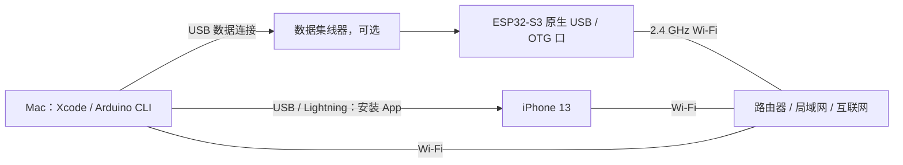
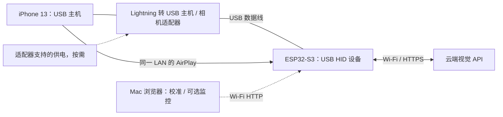
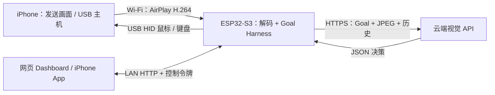
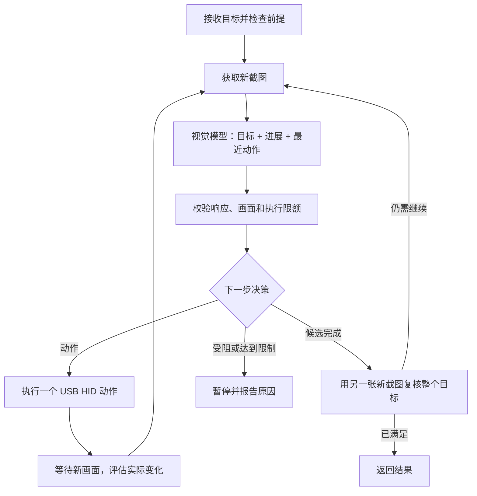

<div align="center">


# ESP32 iPhone Agent · 中文指南

**让 ESP32-S3 围绕一个 Goal，持续观察、决策、操作并验证结果。**

[English](README.md) · [观看 Demo](#在线演示与验证边界) · [项目文档概览](#项目文档概览)

</div>

向 Agent 提交“打开设置，告诉我当前连接的 Wi-Fi 名称”这样的目标。ESP32 接收 iPhone 的 AirPlay 屏幕镜像，
解码画面，调用云端视觉模型选择下一步，再通过 USB 鼠标或键盘执行动作。每一步之后重新观察手机，
根据真实进展调整后续动作；模型提出完成后，还要用另一张新截图复核结果。

iPhone App 负责配置引导和任务提交，网页负责展示手机画面与执行详情。任务循环运行在 ESP32 上，
因此手机可以离开控制 App，让被操作的 App 出现在前台。Mac 用于开发、烧录和可选的网页监控，不承担当前方案的解码或 Agent 推理调度。

> **当前模式：`hardware/flash.sh --cloud`。** 不带 `--cloud` 会构建保留的旧 BLE 桥接固件，
> 与当前默认的 Wi-Fi App 控制台不是同一种运行模式。完整 iPhone USB HID 任务闭环仍待实机验证，详见下方验证记录。

## 当前功能

- 接收 AirPlay，在板上解码 H.264，生成灰度 JPEG 供视觉模型与网页使用。
- Goal 循环记录最近动作、进展摘要、当前子目标和预期变化，每轮按新画面选择下一步。
- 动作无进展时重新规划；临时错误有限重试；完成前再次取图验证。
- 网页和 iOS App 均先通过控制令牌登录，共用板上的 Endpoint、模型与 API Key 配置。
- 网页首屏同时展示手机监控和任务详情，可查看输入、观察、动作参数与执行结果。
- App 提供 12 个任务示例；网页另有无需 HID 的“读懂当前屏幕”，共 13 个。

## 在线演示与验证边界

https://github.com/user-attachments/assets/9aca96ee-38b1-4d52-847c-96a08fae530e

点击上方视频的**播放按钮**，即可直接在 README 首页观看 71 秒 Demo，支持暂停、拖动进度与全屏。
需要按章节浏览时，可打开[中文独立播放器](https://infronai.github.io/esp32-iphone-agent/demo/?lang=zh-CN)，使用 9 个章节跳转；[英文版](https://infronai.github.io/esp32-iphone-agent/demo/?lang=en)的界面、字幕和任务日志均已英文化。

视频使用**真实网页代码与模拟手机画面、任务响应**，展示登录、监控、目标执行、完成复核、重规划、停止和模型配置。
它不是实机 iPhone USB HID 操控成功的录像；视频和播放器均有明确标识。
[查看演示素材与重录方法](docs/demo/README.md)。

## 项目文档概览

以下按硬件、架构、任务流程、数据流、代码和使用顺序展开，让读者在首页即可了解整个项目。
需要完整命令、接线细节或排障步骤时，再进入各节末尾的详细文档。

### 硬件与接线

| 项目 | 本次记录与要求 |
|---|---|
| ESP32 开发板 | **ESP32-S3，16 MB Flash / 8 MB PSRAM**；检测特征对应 **ESP32-S3R8**，芯片修订 v0.2；同规格参考模组：**ESP32-S3-WROOM-1-N16R8** |
| 被控手机 | **iPhone 13**，Lightning 接口 |
| 手机 USB 主机转接器 | 需要 Lightning 转 USB 主机/相机适配器；普通充电数据线无法代替 |
| 网络 | 可访问互联网、支持 ESP32 接入 **2.4 GHz**、允许局域网客户端互访的路由器 |
| 开发电脑 | MacBook Pro，M1 Pro，16 GB 内存；安装 Xcode 和 Arduino CLI |
| 数据线与供电 | 使用板子原生 USB/OTG 口和支持数据传输的线；本次通过集线器开发，供电按板卡和适配器规格连接 |

#### 型号与核心参数

已有检测日志明确记录 `Embedded PSRAM 8MB (AP_3v3)`、QFN56 封装和芯片修订 v0.2，
对照乐鑫型号表，对应 **ESP32-S3R8** 芯片。可检索的同规格参考模组料号是 **ESP32-S3-WROOM-1-N16R8**：
16 MB Quad SPI Flash、8 MB Octal SPI PSRAM、板载 PCB 天线。
这个模组料号用于规格参考，尚未通过当前样机的屏蔽罩或 PCB 丝印确认；整块开发板的品牌/商品型号仍需核对实物。

| 参数 | 规格 / 项目记录 |
|---|---|
| 主 CPU | Xtensa 双核 32 位 LX7，最高 240 MHz，另有 ULP 低功耗协处理器 |
| 片上内存 | 512 KB SRAM、384 KB ROM、16 KB RTC SRAM |
| Flash | 本板记录为 16 MB；当前固件采用 8 MB 分区布局 |
| PSRAM | 封装内置 8 MB，3.3 V Octal SPI；固件设置为 `PSRAM=opi` |
| Wi-Fi | 2.4 GHz，IEEE 802.11 b/g/n |
| 蓝牙 | Bluetooth 5 LE |
| 原生 USB | USB 2.0 OTG Full-Speed，本项目用作 HID 鼠标/键盘设备 |
| 晶振 | 40 MHz，检测日志已记录 |

规格依据：[ESP32-S3 芯片手册](https://documentation.espressif.com/esp32_s3_datasheet_en.pdf)与
[WROOM-1 / WROOM-1U 模组手册](https://documentation.espressif.com/esp32-s3-wroom-1_wroom-1u_datasheet_en.pdf)。

#### 开发环境接线：编译、烧录与调试



- 板子的**原生 USB/OTG 口接 Mac**，可经过支持数据传输的集线器，用于烧录和串口调试；
  iPhone 另接 Mac，用于签名安装 App。
- 验证 App 登录、AirPlay、画面解码、网页监控和云端识图时，让板子、手机、Mac 加入互通的 LAN。
  这套接法中的 USB 主机是 **Mac**。
- 板子仍接 Mac 时，不要确认“USB 已接到 iPhone”，也不要开始指针校准或发送 HID 动作任务。
- 当前构建使用 `FlashSize=8M`、`PartitionScheme=default_8MB`、`PSRAM=opi`。
  物理 Flash 为 16 MB 不会自动扩大固件分区；其他板卡需核对 Flash、PSRAM 和 USB 配置。
  USB-to-UART 下载接口不能代替 HID 所需的原生 USB 连接。

#### 实际运行接线：操控 iPhone



- 将板子原生 USB 数据连接从 Mac 拔下，改接到 **iPhone 的 USB 主机转接器**。
  普通 Lightning 充电数据线无法替代主机转接器；需要额外供电时，按适配器和板卡说明接入。
- 开启辅助触控和“屏幕镜像 → ESP32 Agent”，在 App 核对并确认真实手机接线，再通过网页校准指针。
  USB 枚举成功本身不能证明主机是 iPhone。
- 提交 Goal 后离开手机控制 App。ESP32 负责解码、云端请求和 HID 操作；Mac 作为 Wi-Fi 网页客户端，
  不需要再用 USB 接板子，也不需要运行 Agent 或 Python 服务。
- 手机、ESP32 和监控端处于互通的 LAN。ESP32 接入 **2.4 GHz**；手机和 Mac 可以使用其他频段，
  前提是路由器允许客户端互访和 mDNS 发现。

[完整硬件清单与开发/运行接线说明 →](docs/guide/hardware.md)

### 项目架构与职责



| 组件 | 负责什么 |
|---|---|
| iPhone 系统 | 发送屏幕镜像，运行目标 App，通过 USB 主机与辅助触控接收鼠标/键盘操作 |
| ESP32 视觉链路 | 接收并解密 AirPlay，通过 OpenH264 连续解码，导出最新灰度 JPEG |
| ESP32 Goal Harness | 保存任务上下文，校验模型提案，检查进展与限额，派发动作并复核完成 |
| 云端视觉模型 | 根据截图和目标上下文返回一个结构化决策，不直接调用 USB 驱动 |
| iPhone 控制 App | 手机设置引导、设备自检、任务提交/停止、板上模型配置 |
| 网页控制台 | 手机画面、原始输入与执行时间线，以及任务、指针校准、模型配置 |

HTTP 服务、模型请求和视频处理分别运行；真正的 HID 动作由 Arduino 主循环派发。
动作携带任务和镜像会话标识，停止任务或镜像会话变化后，旧模型响应不能继续执行。
[详细架构、并发与内存说明 →](docs/guide/architecture.md)

### Goal 任务执行流程

Goal 描述的是结果，不是写死的点击脚本。手机已经在目标页面时，可以直接读取并复核；
某一步没有达到预期时，下一轮会根据当前画面与反馈调整策略。



Harness 保存**最近 6 次动作**、进展摘要、当前子目标与预期变化。“HID 已确认”仅表示命令返回，
不能直接当作目标成功；重复动作却没有进展时，会要求换策略，执行结果不确定时不会盲目重放。

每个任务最多 **20 次动作尝试、40 轮模型调用、10 分钟**，连续可重试错误最多重试 2 次。
停止后禁止后续动作，即使模型响应稍后才返回也不继续执行。新任务和重启会清空任务记忆。
[完整业务流程图、异常与终止路径 →](docs/guide/workflow.md)

### 数据流、配置与访问

- **画面流**：iPhone → AirPlay H.264 → ESP32 解码 → 灰度 JPEG。网页读取最新 JPEG，云端收到的是图片，不是原始 H.264。
- **决策流**：Goal、截图、最近动作与反馈 → HTTPS Chat Completions API → 校验后的 JSON → 板上动作队列 → USB HID → 下一张截图。
- **监控流**：网页和 App 通过 LAN HTTP 读取设备状态与任务记录。网页默认 **5 秒**更新一次画面，可选 3 / 10 秒，与视频解码频率、模型响应耗时分别计算。
- **配置流**：ESP32 开机即连接已配置的 Wi-Fi。控制令牌和模型配置保存在 NVS，正常重启后保留；网页与 App 修改的是同一份配置。

控制令牌用于板子 API 鉴权，与云端 API Key 不同。局域网 HTTP 本身不加密；云端请求使用 HTTPS 证书验证。
配置读取接口不会回显模型 Key。截图和任务历史主要保存在运行期缓冲中，不是持久录像服务；
所选模型服务商会接收截图及任务上下文。

优先通过 `http://iphone-agent.local/` 寻址，实际 IP 由 DHCP 分配，不固定在某个地址。
公开的在线 Demo 是录像；真正的设备控制台由自己的 ESP32 在局域网内提供。
[详细数据流图、API 与数据保存位置 →](docs/guide/data-flow.md)

### 代码目录速览

```text
hardware/
  flash.sh                         构建/烧录，--cloud 选择当前模式
  hid_bridge/cloud_agent.cpp       HTTP API、云端请求和任务调度
  hid_bridge/src/cloud/            Harness、动作、解码、记录与嵌入式网页
  hid_bridge/src/airplay/          AirPlay 接收、配对与 mDNS
  tools/                          解码库构建/补丁、资源生成
  tests/                          原生、Harness、网页和解码测试
ios/
  IPhoneAgent/Cloud/               SwiftUI 控制台、板子 API 与手机配置引导
  IPhoneAgent.xcodeproj/           用于签名安装的 Xcode 工程
  IPhoneAgentTests/                iOS 单元测试
shared/task-examples.json           网页与 App 示例任务的共享源
docs/guide/                        完整指南和验证记录
docs/playbooks/                    可复用的研究性项目开源发布流程
docs/demo/                         在线播放器、MP4、海报和章节
tools/demo/                        可重复录制 Demo 的工具
tools/ci/                          可选 GitHub Actions 测试工作流模板
server/ 与 prompts/                保留的旧电脑端/手机端 Agent 实现
```

修改网页从 `src/cloud/control_page.h` 入手，修改循环行为看 `src/cloud/harness.cpp`，修改 App 看 `ios/IPhoneAgent/Cloud/`。
当前板上模型提示词在 `cloud_agent.cpp`；修改旧 `prompts/` 不会改变 ESP32 的 Agent。
[完整目录树与按功能找代码 →](docs/guide/code-map.md)

### 安装流程概览

本次验证使用 **Arduino ESP32 Core 3.3.8**、**NimBLE-Arduino 2.5.1** 和固定源码版本的 **OpenH264 2.6.0**。
App 最低目标为 iOS 18，但构建当前设置跳转代码需要包含 iOS 26.4 或更新 SDK 的 Xcode；实测 Xcode 为 27.1。

1. 按安装文档准备 Xcode、Arduino CLI、指定版本的 ESP32 Core 和 NimBLE。
2. 克隆项目，创建被 Git 忽略的本机固件配置：

   ```bash
   git clone https://github.com/InfronAI/esp32-iphone-agent.git
   cd esp32-iphone-agent
   cp hardware/hid_bridge/secrets.example.h hardware/hid_bridge/secrets.h
   chmod 600 hardware/hid_bridge/secrets.h
   ```

3. 编辑 `secrets.h`，填写自己的 2.4 GHz Wi-Fi、完整 HTTPS Chat Completions 地址、模型名与 Key。
   模型必须真正支持图片；纯文本测试成功不能替代视觉测试。
4. 用原生 USB 连接板子，先编译再烧录，并替换为自己的串口：

   ```bash
   hardware/flash.sh --cloud --debug --build-only
   hardware/flash.sh /dev/cu.usbmodemYOUR_BOARD --cloud --debug
   ```

5. 通过串口命令 `1 agent token` 读取板子的控制令牌。
6. 将 `ios/Config/Local.xcconfig.example` 复制为同目录下的 `Local.xcconfig`，填写自己的签名 Team 和 Bundle ID，
   打开 `ios/IPhoneAgent.xcodeproj`，选择手机并 Run。
7. 登录控制台，开启镜像，把手机接成 USB 主机，开启辅助触控、确认接线并校准后，再执行动作任务。

个人配置、签名材料和含密钥的固件产物不提交 Git。
[完整安装命令、签名和 BOOT 下载模式恢复 →](docs/guide/install.md)

### 日常使用与示例任务

建议从一个只读目标开始：

> 打开设置的 Wi-Fi 页面，告诉我当前连接的网络名称。只查看，不修改设置；验证后停止。

**iPhone App** 用于完成本地网络、镜像和辅助触控配置，并提交 Goal。提交后离开控制 App，让目标 App 显示在手机上。
**网页 Dashboard** 将监控画面与任务进展放在一起，显示原始输入、观察、子目标、动作选择、参数和执行结果。
这些是模型公开的简短说明，不是内部思维链。

| 示例类别 | 包含内容 |
|---|---|
| 设备信息 | Wi-Fi 名称、电池、存储空间、机型与 iOS 版本 |
| 系统设置 | 显示设置、语言与地区、蓝牙设备、屏幕使用时间 |
| 内置 App | 已有闹钟、世界时钟、今日日程、天气 |
| 首次视觉检查 | 网页“读懂当前屏幕”，不发送 HID 动作 |

前提满足时，点击示例即可启动；配置缺失时会引导补齐。需要终止任务时点击“停止”，仅退出控制台不会自动停止板上任务。
如果画面感觉滞后，先区分网页刷新间隔、帧龄、解码耗时和模型等待，再决定是否调整刷新频率。
[日常操作、全部示例、校准与排障 →](docs/guide/manual.md)

### 验证结果与当前限制

| 范围 | 已记录结果 |
|---|---|
| 固件 | 云端版本编译与烧录已验证，当前构建约 1.89 MB |
| iOS 与旧服务端 | 94 项 iOS 模拟器测试、28 项 Python 测试通过 |
| Harness 与控制台 | ASan/UBSan 原生 Harness、动作校验和 Playwright 网页交互测试通过 |
| 视频回归 | 修正后的 OpenH264 在 24 帧捕获上与 FFmpeg 亮度像素一致 |
| 停止机制 | 板子上实测停止后丢弃迟到模型响应，没有发送 HID |
| 完整 iPhone 任务闭环 | **仍待验证**：最后一次验证时缺少所需 Lightning USB 主机转接器 |

最终固件持续镜像的端到端延迟、完整手机 HID Goal 任务仍待补齐实测。
监控采用实际接收分辨率的灰度图片，不是 iPhone 原生高清画面；键盘输入目前只支持 ASCII，任务记忆不跨断电恢复。
其他板卡、手机和模型服务商还需要兼容性验证。

[完整验证证据与限制 →](docs/guide/validation.md) · [可选测试 CI 模板 →](tools/ci/README.md)。
项目测试 CI 尚未启用；在线演示由独立的 GitHub Pages 发布流程提供。

### 详细文档索引

[硬件清单](docs/guide/hardware.md) · [项目架构](docs/guide/architecture.md) ·
[业务流程](docs/guide/workflow.md) · [数据流与 API](docs/guide/data-flow.md) ·
[代码地图](docs/guide/code-map.md) · [安装方法](docs/guide/install.md) ·
[使用手册](docs/guide/manual.md) · [验证记录](docs/guide/validation.md) ·
[Demo 重录](docs/demo/README.md) ·
[研究性项目开源发布 Playbook](docs/playbooks/research-open-source-release.md)

Playbook 将本次发布整理为可复用步骤，涵盖事实与验证边界、公开文件审查、双语首页、分语言 Demo、GitHub 发布和匿名播放验收，并附交付记录模板。

## 来源与许可

本项目基于 [onehumanbeing/esp32-iphone-agent](https://github.com/onehumanbeing/esp32-iphone-agent)，上游基准提交为 `67da886`。
保留原作者与第三方声明，详见 [NOTICE](NOTICE.md)、[LICENSE](LICENSE) 和组件许可文件。
AirPlay/playfair 与 OpenH264 各自适用对应许可，根目录 MIT 声明不能替代这些条款。
[上游历史文档](docs/guide/upstream-readme.zh-CN.md)单独保留，避免与当前云端模式混淆。
