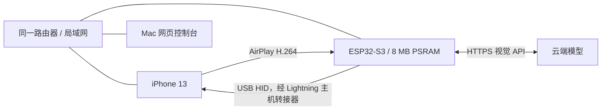

# ESP32 iPhone Agent · 中文指南

**在 ESP32-S3 上完成“观察 → 决策 → 操作 → 验证”的 iPhone Goal 执行循环。**

[English](README.md) · [完整文档](docs/guide/README.md) · [演示视频](docs/demo/demo.mp4)

当前版本让 ESP32 自己接收 iPhone 屏幕镜像、解码 H.264、生成灰度 JPEG、调用云端视觉模型，
然后通过 USB HID 鼠标和键盘操作手机。iPhone App 负责手机配置与任务提交；网页负责监控手机画面和每轮执行详情。
手机离开本 App 后，任务循环继续运行在 ESP32 上。

> 当前安装方式是 `hardware/flash.sh --cloud`。省略 `--cloud` 会编译保留的旧版 BLE 桥接固件，
> 与当前默认的 Wi-Fi App 控制台不是同一种运行模式。

## 先看效果

[观看/下载 MP4](docs/demo/demo.mp4) · [章节与重录方法](docs/demo/README.md)

视频使用**真实网页代码 + 模拟手机画面和任务响应**，全程有标识。它展示登录、监控、任务输入、
执行进展、完成复核、停止和模型配置，**不代表真机 USB HID 操控全流程已经验证成功**。
真实完成的测试和剩余验证项见[验证记录](docs/guide/validation.md)。

## 硬件与连接

本次板卡实测为 ESP32-S3 rev. 0.2、16 MB Flash、8 MB PSRAM，品牌与丝印型号未确认。
固件使用 8 MB 分区布局。iPhone 13 需要 Lightning 转 USB 主机/相机转接器，普通充电数据线不能代替；
USB 显示连接也不能自动证明主机是 iPhone。详见[硬件清单与接线](docs/guide/hardware.md)。

## 功能

- 先输入控制令牌，再进入显示 ESP32 真实状态的 Dashboard。
- `iphone-agent.local` 自动解析当前地址；不要求固定 DHCP IP。
- 首屏并排显示手机监控和任务执行详情；默认 5 秒刷新，可选 3 / 10 秒。
- Goal 循环保存最近 6 次动作和反馈，按当前画面调整子目标。
- 重复无进展时重新规划；完成前用新截图再次复核。
- 每个任务最多 20 次动作、40 轮模型调用、10 分钟；临时错误最多重试 2 次。
- 网页和 App 共用板子上的 API Endpoint、模型和 Key 配置。
- App 有 12 个任务示例；网页增加“读懂当前屏幕”，共 13 个。

## 从哪里开始

| 需要了解 | 文档 |
|---|---|
| 买什么、怎么接、哪些型号已验证 | [硬件清单](docs/guide/hardware.md) |
| 谁负责解码、调用模型、操作手机 | [项目架构](docs/guide/architecture.md) |
| 配置、任务循环、异常处理的业务流程图 | [业务流程](docs/guide/workflow.md) |
| 视频、Goal、令牌、API 请求经过哪里 | [数据流图与接口](docs/guide/data-flow.md) |
| 想修改某个功能，应该找哪个文件 | [代码目录结构](docs/guide/code-map.md) |
| 从零安装工具、烧录、签名安装 App | [安装方法](docs/guide/install.md) |
| 日常使用、校准、设置、示例和故障排查 | [使用手册](docs/guide/manual.md) |
| 什么已实测、什么还不能承诺 | [验证与限制](docs/guide/validation.md) |

[GitHub Actions 配置](tools/ci/README.md)以模板形式提供，当前未启用远程 CI；本地测试结果见验证记录。

本项目保留上游作者与第三方许可，见 [NOTICE](NOTICE.md) 和 [LICENSE](LICENSE)。
仓库提供完整源码、示例配置、文档和可重录的演示；个人密钥、Wi-Fi 密码、设备令牌、签名文件、私有屏幕录像和含密钥的固件产物不上传。
