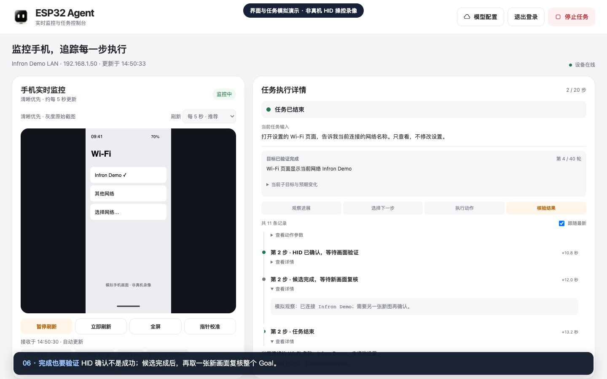

# Demo：网页监控与 Goal 循环

[▶ 在线播放视频](https://infronai.github.io/esp32-iphone-agent/demo/) · [下载 MP4](demo.mp4) · [返回项目](../../README.zh-CN.md)

[](https://infronai.github.io/esp32-iphone-agent/demo/)

## 这段视频展示什么

本次导出为约 **71 秒、1440×900** 的 MP4。

视频由项目实际的嵌入式网页 `control_page.h` 录制，覆盖架构、令牌登录、首屏监控、示例任务、
输入 Goal、每轮观察和动作、完成复核、卡住重规划、停止、模型配置。

**手机屏幕和任务响应全部是模拟夹具；不是实机 USB HID 任务录像。**
视频全程显示这一标识；脚本拦截所有网络，不能连接真实板子或云端模型，也不会发鼠标键盘指令。
“停止”等交互是实际网页逻辑，服务响应由本地夹具提供。

真实已经验证的能力与待补充项见[验证说明](../guide/validation.md)。

## 在线播放器

[打开在线视频](https://infronai.github.io/esp32-iphone-agent/demo/)。原生播放器支持播放/暂停、拖动进度、全屏和移动端内联播放；章节按钮按 `chapters.json` 跳转。
视频与页面由同一仓库的 GitHub Pages 提供，不需要下载或登录。

播放器源码为 `docs/demo/index.html`。GitHub Pages 从 `main` 分支的 `/docs` 发布，`docs/.nojekyll` 保留静态文件原样。
修改页面、视频或章节后推送至 `main`，等待 Pages 部署完成即可更新；这个发布流程与 `tools/ci` 中尚未启用的测试工作流分开。

## 重录

需要 Node.js 20+、ffmpeg，以及 Playwright Chromium 或本机 Google Chrome：

```bash
npm ci --prefix tools/demo
cd tools/demo
npx playwright install chromium
cd ../..
node tools/demo/record-demo.cjs
```

录制脚本用 Playwright 抓取实际页面的 PNG 帧，再由 ffmpeg 合成视频，以保留界面浅色层次。
macOS 已安装 Chrome 时可指定浏览器与编码器路径（ffmpeg 路径替换成你的 `command -v ffmpeg` 输出）：

```bash
CHROME_PATH='/Applications/Google Chrome.app/Contents/MacOS/Google Chrome' \
  DEMO_FFMPEG=/opt/homebrew/bin/ffmpeg \
  node tools/demo/record-demo.cjs
```

输出：

- `docs/demo/demo.mp4`：H.264 / yuv420p / faststart，无旁白，中文字幕嵌入画面。
- `docs/demo/poster.jpg`：来自录制页面的演示海报。
- `docs/demo/chapters.json`：自动记录章节时间和解说文本。
- `build/demo/`：忽略 Git 的原始 PNG 帧及时间表。

修改 `record-demo.cjs` 可更换示例目标和合成手机画面。录制中出现的是 `DEMO-TOKEN`、私网示例地址与 example 域名，
不应替换成真实 API Key、用户网络名称或私人画面。如果后续录制实机任务，请明确修改视频标识和验证说明。
