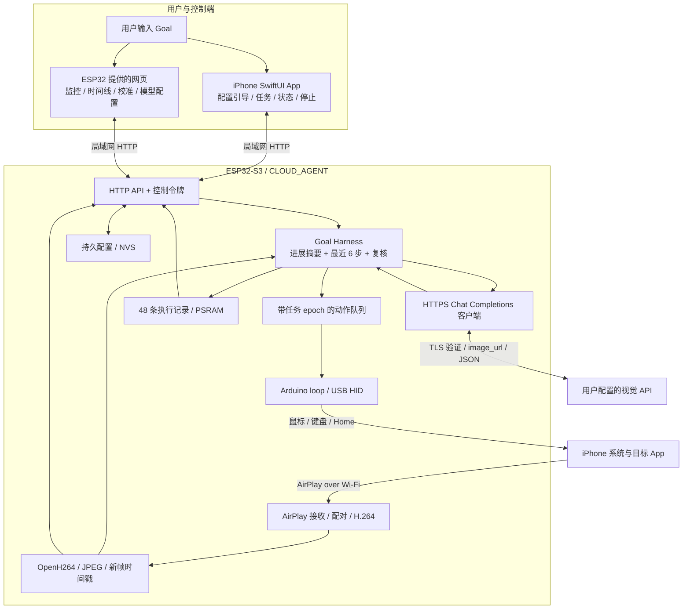

# 项目架构

[返回导航](README.md) · [业务流程](workflow.md) · [数据流](data-flow.md)

## 当前运行模式

## 职责边界

| 组件 | 做什么 | 不承担什么 |
|---|---|---|
| iPhone 系统 | 屏幕镜像、目标 App、USB 主机、辅助触控 | 不运行当前 Goal 推理循环 |
| iPhone 控制 App | 登录、读取真实状态、配置引导、发任务、API 配置、停止 | 不展示监控截图，不中转视频，不在后台推理 |
| 网页 Dashboard | 首屏监控与执行记录、刷新控制、指针校准、任务与示例 | 不代替手机完成辅助触控/镜像配置 |
| ESP32 AirPlay | 接收、解密并输出 H.264 参数和访问单元 | 不把原始 H.264 发给云端 |
| ESP32 视觉模块 | 连续解码参考帧，导出灰度 JPEG，发布时间戳与诊断 | 不通过跳过 P 帧来降低显示刷新率 |
| ESP32 Harness | 原始 Goal、短期记忆、进展判断、约束、重试、复核、动作调度 | 不把 HID 确认直接当作目标成功 |
| 云端模型 | 根据新截图和上下文返回一个结构化决策 | 不能直接调用 USB 驱动，也不持有控制台令牌 |

## 并发与动作隔离

- `cloud_http` 在独立 FreeRTOS 任务中处理网页、状态、停止等请求。
- `cloud_llm` 负责上下文组装、HTTPS 调用和 Harness 循环。模型慢响应不会阻塞 HTTP 服务。
- H.264 解码任务连续处理输入；只对独立的 JPEG 导出进行节流。
- **只有 Arduino `loop()` 中的 `cloud_poll()` 执行 HID**，模型任务只把已验证的动作放入队列。
- 动作携带任务 `epoch` 和镜像 generation。停止、镜像改变、USB 主机失效会阻止旧动作继续执行。
- 停止会立即撤销执行资格；已经发出的 HTTPS 请求可能继续等待网络返回，但其旧响应不能恢复执行。

## 视觉与内存

本次 iPhone 13 的实际 H.264 竖屏为 334×720。接收端宣告参数为 640×360 / 1 fps，iPhone 会按自身屏幕比例选择输出，
因此宣告分辨率不能直接写成实际收到的分辨率。仪表盘显示实测尺寸。

OpenH264 对所有依赖帧解码，导出 JPEG 质量参数 90。使用灰度可减少 RGB 缓冲；不宣称这是高清原生 iPhone 分辨率。
网页默认每 5 秒读取一个最新 JPEG，可改为 3 / 10 秒。显示刷新间隔与 H.264 输入速率是两个独立参数。

解码器适配修正长期参考帧编号，并在 I/P 流上排空不必要的显示等待；B/SP/SI 帧不属于当前实时路径支持范围。
参考帧错误或队列溢出会使画面失效，不继续以旧图驱动动作。细节见 `vision.cpp`、`h264_live.h`、`cloud_deps.py`。

## Goal Harness

每轮模型输入包含原始 Goal、当前 JPEG、已有进展摘要、当前子目标、上一动作预期、最近 6 次动作/确认、循环反馈。
模型返回 `action`、`observation`、`summary`、`progress`、`reason` 等字段；这些是公开的观察和简短说明，不是内部思维链。

- `progress`：advanced / unchanged / regressed / unknown。
- 动作还需 `subgoal` 和 `expected`；每轮最多派发一个动作。
- `done` 必须附最终答案和当前可见证据，随后再取新图独立复核。
- `blocked` 进入暂停；失败、未知和部分完成不写成成功。
- 限额：20 次动作尝试、40 轮模型调用、10 分钟；连续可重试错误最多重试 2 次。
- 最近动作和摘要保存在 PSRAM，重启或提交新 Goal 会清空；当前没有跨断电恢复任务的机制。

## 三种源码路径

| 模式 | 固件 / 入口 | 状态 |
|---|---|---|
| ESP32 自主云端 | `flash.sh --cloud`；App `CloudController` | 当前文档与默认 App |
| iPhone 端 Agent + BLE | 不带 `--cloud` 的固件；旧 AgentLoop / BoardLink | 历史实现保留；不能当作当前 App 的默认安装组合 |
| Python 电脑端 | `server/` | 早期版本保留，不参与当前主链路 |

旧 `prompts/` 用于手机端 Agent。当前 ESP32 的系统提示在 `cloud_agent.cpp`；修改旧 prompts 不会改变板上 Harness。
