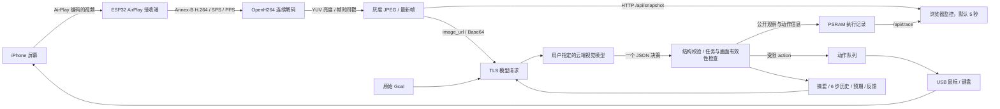

# 数据流图与接口

[返回导航](README.md)

## 视频、决策和控制数据流



**原始 H.264 不直接发给 Chat Completions API**。板子先解码再生成 JPEG。当前云端模式也不通过 BLE 传图或下发动作。

## 一轮交互时序

```mermaid
sequenceDiagram
    actor User as 用户
    participant UI as 网页 / iPhone App
    participant HTTP as ESP32 HTTP
    participant Harness as Goal Harness
    participant Video as 最新画面
    participant LLM as 视觉 API
    participant Loop as Arduino loop / HID
    User->>UI: 输入 Goal
    UI->>HTTP: POST /api/start + Bearer 控制令牌
    HTTP->>HTTP: 检查前提 / 创建 epoch
    HTTP-->>UI: ok（任务已接收，并非完成）
    loop 观察、决策、执行、验证
        Harness->>Video: 获取最新 JPEG / 时间戳 / generation
        Video-->>Harness: 图像与元数据
        Harness->>LLM: HTTPS：Goal + JPEG + 历史
        LLM-->>Harness: 结构化决策
        Harness->>Harness: 校验 / 进展与预算 / 新旧画面检查
        alt 一个可执行动作
            Harness->>Loop: epoch + action
            Loop-->>Harness: 执行确认或失败
            Harness->>Video: 等待动作后的稳定新帧
        else 候选完成
            Harness->>Video: 获取另一张新图
            Harness->>LLM: 独立复核完整 Goal
        else 被阻塞
            Harness->>HTTP: paused + 原因
        end
        UI->>HTTP: GET /api/status /api/trace
        HTTP-->>UI: 真实状态、进展与记录
    end
    User->>UI: 停止
    UI->>HTTP: POST /api/stop
    HTTP->>Harness: 使旧 epoch 失效
    Note over Harness,Loop: 迟到响应不可执行；HTTP 返回后 UI 才确认停止
```

## 数据保存在哪里

| 数据 | 位置 | 生命周期 / 说明 |
|---|---|---|
| Wi-Fi 初始配置 | 本地 `secrets.h` → 编译固件；另有网络 NVS | 不提交 Git；`--cloud` 开机按构建时配置加入路由器 |
| 控制令牌 | ESP32 NVS | 首次随机生成；普通重启保留；与 API Key 不同 |
| 模型 Endpoint / Model / Key | ESP32 NVS 的一个配置值 | 网页和 App 共用；Key 不通过 GET 返回；不是加密密钥保险箱 |
| 当前 JPEG / 解码参考帧 | ESP32 PSRAM | 运行期缓冲；屏幕失效后不用于执行；不默认保存录像 |
| Goal / 最近 6 步记忆 | ESP32 PSRAM | 每任务；重启或新任务清空 |
| 最多 48 条执行事件 | ESP32 PSRAM | 环形缓冲，旧记录释放；记录可能截断，不是永久审计数据库 |
| App 控制令牌 | 当前 App 会话 | 冷启动重新登录；退出清除 |
| 网页登录令牌 | 页面内存；勾选记住时用 sessionStorage | 当前浏览器会话；退出清除；退出不会自动停止板上任务 |
| 发送给视觉 API 的内容 | 用户指定的服务商 | Goal、截图、最近动作摘要；适用该服务商的数据规则 |

局域网控制台使用 HTTP，控制令牌用于访问控制，**并不为 LAN 传输提供加密**。
云端请求使用 HTTPS 和证书验证，依赖网络时间同步。当前默认构建未开启 NVS 加密；不要公开个人固件、NVS dump 或调试截图。
完整数据说明见[隐私说明](../privacy.md)。

## HTTP API

除静态资源和 `/api/health` 外，接口要求 `Authorization: Bearer <control-token>`。
POST 还要求 `Content-Type: application/json`。示例令牌只从环境读取，文档没有任何真实凭据。

| 方法 / 路径 | 作用 | 主要字段或前提 |
|---|---|---|
| `GET /api/health` | 公开连通性 | service、wifi_connected；不返回任务与凭据 |
| `GET /api/status` | 实时状态 | state/detail/running/steps、USB/镜像/画面诊断、harness |
| `GET /api/trace` | 当前任务记录 | revision、goal、events、dropped；无 Key 或图片 Base64 |
| `GET /api/snapshot` | 最新 JPEG | 需要活动镜像和 5 秒内的帧；返回帧龄和时间戳响应头 |
| `GET /api/config` | 模型配置概况 | endpoint、model、key_set |
| `POST /api/config` | 更新配置 | endpoint/model/api_key；Key 留空保留原值；任务忙时拒绝 |
| `POST /api/start` | 提交 Goal | `{"goal":"..."}`，1..1024 UTF-8 字节；全部执行条件就绪 |
| `POST /api/stop` | 停止任务 | `{}`；使旧任务响应与动作失效 |
| `POST /api/test` | 云端文本连接测试 | `{}`；不发送 HID |
| `POST /api/vision-test` | 描述当前真实画面 | `{}`；需要新截图，不发送 HID |
| `POST /api/phone-host` | 记录用户确认的 USB 接线 | `{"confirmed":true}`；并非自动识别 USB 主机类型 |
| `POST /api/calibration-begin` | 移动真实指针做校准 | `{}`；会发送 HID，必须已接手机 |
| `POST /api/calibration-finish` | 保存校准 | 归一化 x/y；只在校准会话内接受 |

响应错误：未授权 401、POST 类型不对 415、任务过长 413、前提或状态冲突 409。
请求接收成功不等于任务完成，应持续读取 `state/detail/harness`。

```bash
export BOARD_URL=http://iphone-agent.local
read -r -s CONTROL_TOKEN
curl --fail --silent --show-error \
  -H "Authorization: Bearer $CONTROL_TOKEN" \
  "$BOARD_URL/api/status"
unset CONTROL_TOKEN
```

`frame_age_ms` 从压缩帧抵达 ESP32 的时间算起，不是 iPhone 采集到浏览器呈现的端到端延迟。
浏览器再叠加下载耗时与显示等待；5 秒刷新本身也会带来可见等待。
