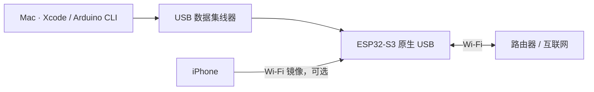
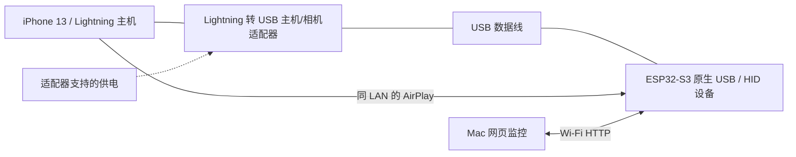

# 硬件清单与接线

[返回文档导航](README.md)

## 本次使用的设备

| 项目 | 型号 / 规格 | 数量 | 用途与验证状态 |
|---|---|---:|---|
| 主控开发板 | ESP32-S3，QFN56，rev. 0.2，240 MHz；实测 16 MB Flash、8 MB PSRAM | 1 | 已烧录并联网；开发板品牌和丝印型号未确认，不能写成 XIAO 或 DevKitC-1 |
| 被控手机 | Apple iPhone 13，Lightning 接口 | 1 | 已安装 App；镜像接收和历史截图识别已测；当前完整 HID 闭环待验证 |
| 开发电脑 | MacBook Pro（MacBookPro18,1），Apple M1 Pro，16 GB 内存 | 1 | 编译、签名、烧录、网页监控、测试、录制 Demo |
| 无线路由器 | 支持 2.4 GHz，提供互联网，允许局域网客户端互访 | 1 | 具体品牌未记录；ESP32、手机、Mac 位于同一可互通 LAN |
| USB 集线器 | Mac 兼容的数据型 USB 集线器 | 1 | 本次因接口不足，通过集线器连接板子烧录；型号未记录 |
| ESP32 数据线 | 与板子原生 USB/OTG 接口匹配的数据线 | 1 | 必须具有数据线芯；只充电线不能烧录或传 HID |
| iPhone USB 主机转接器 | **Lightning 转 USB 主机/相机转接器**，例如 Apple Lightning to USB 3 Camera Adapter 类产品 | 1 | iPhone 13 完整操控所需；本次用户仅有普通 Lightning 数据线，此适配器尚未实测 |
| 可选供电 | 转接器允许的外接供电、或板卡说明允许的 5 V 供电方式 | 按需 | 提供稳定供电；额外电源不能改变普通 Lightning 数据线的主机角色 |

这是一份实际设备记录，不是已验证全部兼容型号的采购清单。其他 ESP32-S3 开发板需要逐项确认原生 USB、Flash、PSRAM 类型及供电方式。
上游曾使用的 Seeed XIAO ESP32S3 不能据此认定为本次板卡型号。

## 主控兼容条件

- 必须是具备所需原生 USB 能力的 ESP32-S3。USB-to-UART 下载接口不能自动充当 HID 接口。
- 当前构建指定 `PSRAM=opi`，按 **8 MB PSRAM** 调优，解码器主要分配在 PSRAM。
- 当前构建指定 `FlashSize=8M`、`PartitionScheme=default_8MB`；物理 16 MB 不代表自动使用 16 MB 分区。
- ESP32-S3 通过 **2.4 GHz Wi-Fi** 接路由器；手机/Mac 可在同一路由器的其他频段，只要二层/三层互通且不隔离 mDNS。
- 原生 USB 通道与 UART 接口的区别、引脚和供电限制以实际板卡资料为准。ESP32-S3 芯片具有 USB OTG，但开发板是否正确引出该接口需要确认。

芯片能力参考 [Espressif ESP32-S3 数据手册](https://documentation.espressif.com/esp32_s3_datasheet_en.pdf) 和
[USB 硬件设计说明](https://docs.espressif.com/projects/esp-hardware-design-guidelines/en/latest/esp32s3/schematic-checklist.html)。

## 开发 / 烧录时

这时 USB 主机是 **Mac**。固件可能显示 `usb: ok`，但这不表示已经连接手机。
不要在 App 中确认“USB 已接到 iPhone”，也不要执行指针校准或动作任务，否则鼠标/键盘可能作用于 Mac。
文本连接测试和网页“读懂当前屏幕”不会发送 HID，可用于分段验证。

## iPhone 13 运行时

1. 从 Mac 拔下板子的原生 USB 数据连接。
2. 用主机转接器把板子接到 iPhone；需要供电时按转接器/板卡文档接线，不自行假定多个电源输入可以并接。
3. 保持手机解锁，开启辅助触控和屏幕镜像。
4. 在手机 App 核对物理接线，再确认手机 USB 主机连接。
5. 在 Mac 网页中完成指针校准。此时 Mac 只通过 Wi-Fi 访问控制台。

Apple 的指针设备说明见[使用 AssistiveTouch 连接指针设备](https://support.apple.com/en-au/111775)。
USB-C iPhone 也应确认手机处于 USB 主机角色、数据线和供电匹配；本仓库没有把其他机型标记为已完成整机验证。

## 不需要的硬件

当前云端模式不需要摄像头、HDMI 采集卡、显示屏或额外蓝牙指令发送器。
画面来自 AirPlay，决策来自云端 API，控制通过 USB HID。Mac 不参与正常运行时的解码和模型决策。
