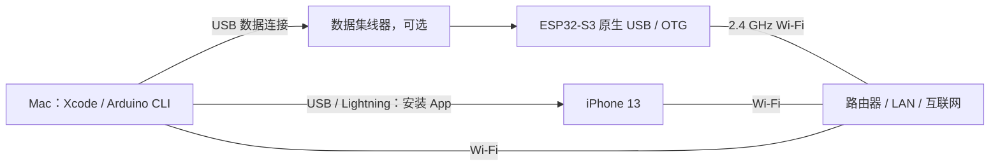
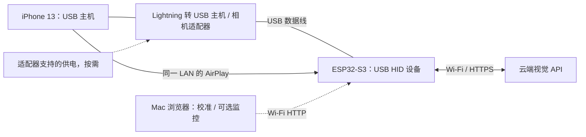

# 硬件清单与接线

[返回文档导航](README.md)

## 本次使用的设备

| 项目 | 型号 / 规格 | 数量 | 用途与验证状态 |
|---|---|---:|---|
| 主控开发板 | 芯片特征对应 **ESP32-S3R8**（推定），QFN56，rev. v0.2；16 MB Flash、8 MB PSRAM | 1 | 已烧录并联网；同规格参考模组 **ESP32-S3-WROOM-1-N16R8**，载板商品型号仍需核对实物丝印 |
| 被控手机 | Apple iPhone 13，Lightning 接口 | 1 | 已安装 App；镜像接收和历史截图识别已测；当前完整 HID 闭环待验证 |
| 开发电脑 | MacBook Pro（MacBookPro18,1），Apple M1 Pro，16 GB 内存 | 1 | 编译、签名、烧录、网页监控、测试、录制 Demo |
| 无线路由器 | 支持 2.4 GHz，提供互联网，允许局域网客户端互访 | 1 | 具体品牌未记录；ESP32、手机、Mac 位于同一可互通 LAN |
| USB 集线器 | Mac 兼容的数据型 USB 集线器 | 1 | 本次因接口不足，通过集线器连接板子烧录；型号未记录 |
| ESP32 数据线 | 与板子原生 USB/OTG 接口匹配的数据线 | 1 | 必须具有数据线芯；只充电线不能烧录或传 HID |
| iPhone USB 主机转接器 | **Lightning 转 USB 主机/相机转接器**，例如 Apple Lightning to USB 3 Camera Adapter 类产品 | 1 | iPhone 13 完整操控所需；本次用户仅有普通 Lightning 数据线，此适配器尚未实测 |
| 可选供电 | 转接器允许的外接供电、或板卡说明允许的 5 V 供电方式 | 按需 | 提供稳定供电；额外电源不能改变普通 Lightning 数据线的主机角色 |

这是一份实际设备记录，不是已验证全部兼容型号的采购清单。其他 ESP32-S3 开发板需要逐项确认原生 USB、Flash、PSRAM 类型及供电方式。
上游曾使用的 Seeed XIAO ESP32S3 不能据此认定为本次板卡型号。

## 具体型号、核心参数与识别依据

芯片、模组和整块开发板是三个不同层级。本项目可以给出具体的芯片规格和模组参考料号，
载板上的 USB 接口、稳压器、引脚和品牌型号仍以实际 PCB 为准。

| 层级 | 具体名称 / 规格 | 依据 |
|---|---|---|
| 芯片系列 | ESP32-S3，QFN56，芯片修订 v0.2 | 烧录检测日志 |
| 芯片具体料号 | **ESP32-S3R8** | 根据日志的封装内置 8 MB、3.3 V PSRAM 特征，对照官方型号表推定 |
| 当前样机内存 | **16 MB Flash / 8 MB PSRAM** | 项目既有实测记录；当前日志进一步确认内置 8 MB PSRAM |
| 同规格模组参考 | **ESP32-S3-WROOM-1-N16R8** | 官方料号：16 MB Quad SPI Flash、8 MB Octal SPI PSRAM、PCB 天线 |
| 整块开发板商品型号 | 待核对 PCB 和模组屏蔽罩丝印 | 无法仅凭芯片 revision、容量或固件 USB 描述符唯一确定 |

检测日志中的非敏感摘录：

```text
Chip type:          ESP32-S3 (QFN56) (revision v0.2)
Features:           Wi-Fi, BT 5 (LE), Dual Core + LP Core, 240MHz, Embedded PSRAM 8MB (AP_3v3)
Crystal frequency:  40MHz
```

`rev. v0.2` 是芯片修订号，不是开发板型号；Arduino 的 `ESP32S3 Dev Module` 也是通用构建目标。
`ESP32-S3R8` 的判断来自芯片特征与官方表格的对应关系，不能据此认定当前样机一定焊有 WROOM-1 模组。
模组参考中的 `N16R8` 表示 16 MB Flash 与 8 MB PSRAM 配置；它本身不是载板品牌。

### 核心参数

| 参数 | 规格 | 项目相关说明 |
|---|---|---|
| 主处理器 | Xtensa 双核 32 位 LX7，最高 240 MHz | 运行 AirPlay 接收、解码、HTTP 和任务调度 |
| 低功耗处理器 | ULP 协处理器 | 不等同于第三个 240 MHz 应用 CPU |
| 片上 SRAM | 512 KB | 内部工作内存，不能与 8 MB PSRAM 混为一项 |
| ROM / RTC SRAM | 384 KB / 16 KB | 芯片规格 |
| Flash | 样机记录 16 MB | 当前构建只选择 8 MB 分区布局 |
| PSRAM | 8 MB、3.3 V、Octal SPI，封装内置 | 对应 `PSRAM=opi`，用于解码与图像/任务缓冲 |
| Wi-Fi | 2.4 GHz IEEE 802.11 b/g/n | 接路由器访问局域网与云端 API |
| 蓝牙 | Bluetooth 5 LE | 当前自主云端主链路不依赖 BLE 下发动作 |
| 原生 USB | USB 2.0 OTG Full-Speed；另有 USB Serial/JTAG 控制器 | 本项目通过 OTG 外设功能实现 HID 鼠标和键盘 |
| 主晶振 | 40 MHz | 检测日志已确认 |

`ESP32-S3-WROOM-1-N16R8` **参考模组本体**使用 PCB 天线，尺寸为 18.0 × 25.5 × 3.1 mm，
推荐供电 3.0–3.6 V（典型 3.3 V）。这些是模组参数，不是整块开发板尺寸或 USB 电源输入规格。
选择成品板时，应确认它确实搭载相应内存配置，并将原生 USB 引出为可用的数据接口。

依据：[ESP32-S3 数据手册 v2.2 的型号对照与功能说明](https://documentation.espressif.com/esp32_s3_datasheet_en.pdf)、
[WROOM-1 / WROOM-1U 数据手册 v1.8 的型号表、供电与尺寸](https://documentation.espressif.com/esp32-s3-wroom-1_wroom-1u_datasheet_en.pdf)。

## 主控兼容条件

- 必须是具备所需原生 USB 能力的 ESP32-S3。USB-to-UART 下载接口不能自动充当 HID 接口。
- 当前构建指定 `PSRAM=opi`，按 **8 MB PSRAM** 调优，解码器主要分配在 PSRAM。
- 当前构建指定 `FlashSize=8M`、`PartitionScheme=default_8MB`；物理 16 MB 不代表自动使用 16 MB 分区。
- ESP32-S3 通过 **2.4 GHz Wi-Fi** 接路由器；手机/Mac 可在同一路由器的其他频段，只要二层/三层互通且不隔离 mDNS。
- 原生 USB 通道与 UART 接口的区别、引脚和供电限制以实际板卡资料为准。ESP32-S3 芯片具有 USB OTG，但开发板是否正确引出该接口需要确认。

芯片能力参考 [Espressif ESP32-S3 数据手册](https://documentation.espressif.com/esp32_s3_datasheet_en.pdf) 和
[USB 硬件设计说明](https://docs.espressif.com/projects/esp-hardware-design-guidelines/en/latest/esp32s3/schematic-checklist.html)。

## 开发环境接线：编译、烧录与调试



1. 板子原生 USB 接 Mac，可使用数据集线器；用 Arduino CLI 构建、烧录、读取串口日志与控制令牌。
2. iPhone 另用普通 Lightning 数据线接 Mac，完成 Xcode 签名安装 App。这条线用于 Mac 与手机的数据连接。
3. 联调时让板子、手机和 Mac 加入互通的 LAN，验证登录、镜像、解码、网页画面和云端识图。
4. 当前构建采用 `FlashSize=8M`、`PartitionScheme=default_8MB`、`PSRAM=opi`，物理 16 MB Flash 不会自动改变分区。

**此时 USB 主机是 Mac。** `usb: ok` 仅表明枚举成功。不要在 App 确认手机主机接线，不要校准指针或启动 HID 动作任务。
文本模型测试和“读懂当前屏幕”不发送 HID，适合在这个阶段验证。

## 实际应用场景接线：操控 iPhone



1. 将板子原生 USB 数据连接从 Mac 拔下，接到 iPhone 的 Lightning USB 主机/相机转接器。
2. 按转接器和板卡说明提供电源；额外供电本身不会让普通 Lightning 数据线变成主机适配器。
3. 手机保持解锁，开启辅助触控与“屏幕镜像 → ESP32 Agent”，确认手机上出现真实指针。
4. 在 App 核对并确认物理接线，再在网页里校准指针。USB 枚举不能代替手机主机接线确认。
5. 从 App 或网页提交 Goal，随后离开手机控制 App，让目标 App 处于前台。解码、模型请求和 HID 均由 ESP32 完成。

Mac 在此场景通过 Wi-Fi 提供网页校准和可选监控，不需要 USB 连接，也不需要运行 Python 服务或模型代理。
手机、板子和监控端处于互通 LAN；板子接入 2.4 GHz，手机/Mac 可在其他频段，但须允许客户端互访和 mDNS 发现。

Apple 的指针设备说明见[使用 AssistiveTouch 连接指针设备](https://support.apple.com/en-au/111775)。
USB-C iPhone 也需确认手机处于 USB 主机角色，数据线和供电匹配；其他机型尚未完成整机验证。

## 不需要的硬件

当前云端模式不需要摄像头、HDMI 采集卡、显示屏或额外蓝牙指令发送器。
画面来自 AirPlay，决策来自云端 API，控制通过 USB HID。Mac 不参与正常运行时的解码和模型决策。
