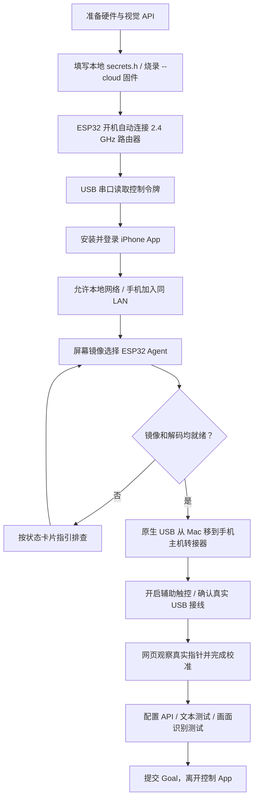
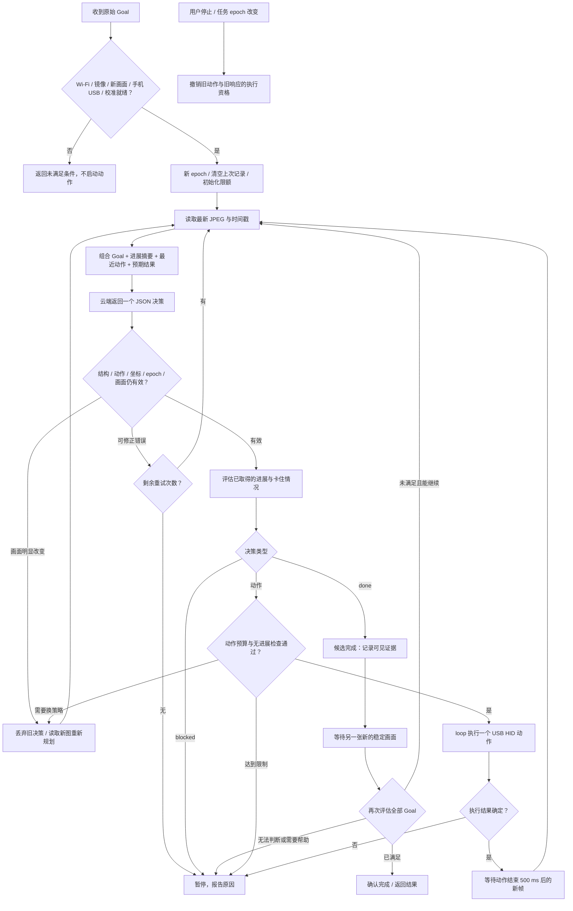

# 业务流程图

[返回导航](README.md)

## 首次配置

登录令牌仅用于控制 API 鉴权，不负责触发联网。USB 枚举正常也不等于已确认手机主机。
“读懂当前屏幕”不需要 USB 或指针校准，可用于先验证视觉路径。

## Goal 主循环

## 进展、异常与结束

| 情况 | 当前行为 |
|---|---|
| HID 返回 ok | 只记录“命令已确认”；继续等待新截图验证实际变化 |
| 模型暂时超时、HTTP 408 / 429 / 5xx | 有限重试，重新观察；不重放上一条 HID 动作 |
| JSON 错误或字段缺失 | 将格式问题作为反馈重新请求，最多重试 2 次 |
| 同一动作连续无进展 | 拦截重复动作，要求换策略；反复提出同样无效方案则暂停 |
| 4 次动作仍无已确认视觉进展 | 暂停并要求用户检查 |
| 模型推理期间画面明显变化 | 丢弃旧提案，重新读取截图 |
| 动作部分执行 / 确认超时 | 暂停，避免重复输入或重复提交 |
| 无新画面 / 镜像重建 / 手机断开 USB | 暂停，不继续使用旧画面 |
| 20 动作 / 40 模型调用 / 10 分钟 | 达到限额后暂停；最后动作后仍可在总限额内完成复核 |
| 模型第一次说 done | 尚未完成；必须等待新图并再次评估 |
| 用户停止 | 立即禁止后续动作；迟到的模型响应丢弃 |
| 断电或新 Goal | 任务记忆和执行记录清空；配置继续保存在 NVS |

## 一个示例

Goal：**打开设置的 Wi-Fi 页面，告诉我当前网络，只查看，不修改。**

可能的路径：观察主屏幕 → 打开设置 → 观察设置页 → 进入 Wi-Fi → 读取当前网络 → 提出完成 → 新画面复核 → 返回结果。
如果手机已经在 Wi-Fi 页，模型可以直接提出完成并复核，不必机械重复上述路径；如果某一步没有达到预期，则按实际画面改选下一步。
